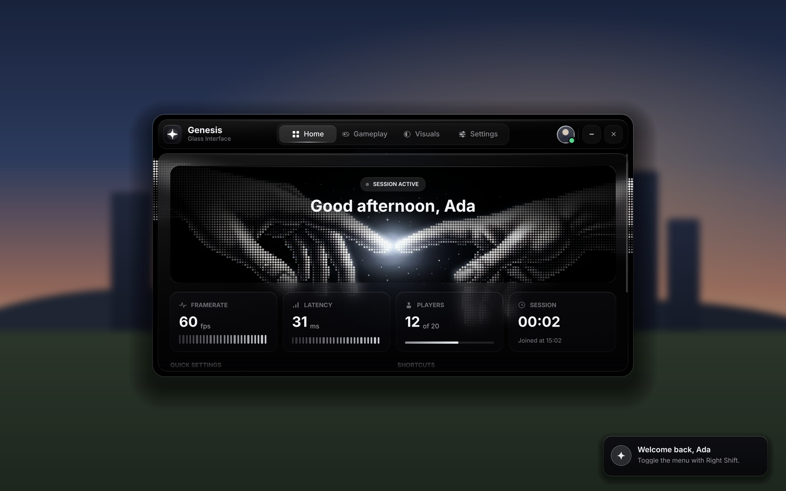
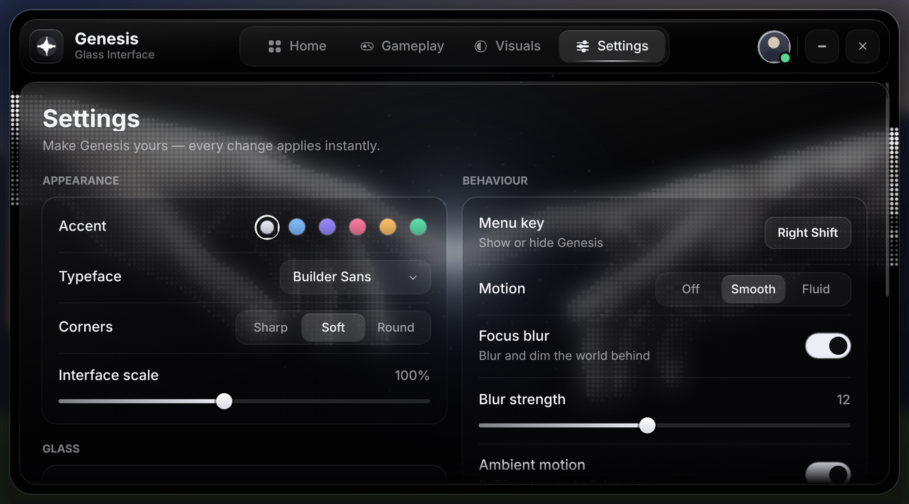
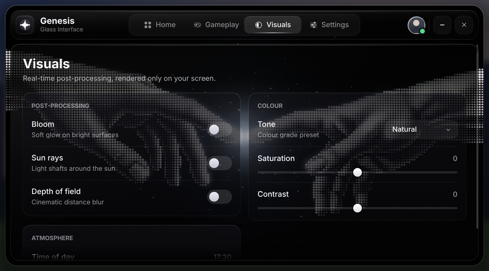
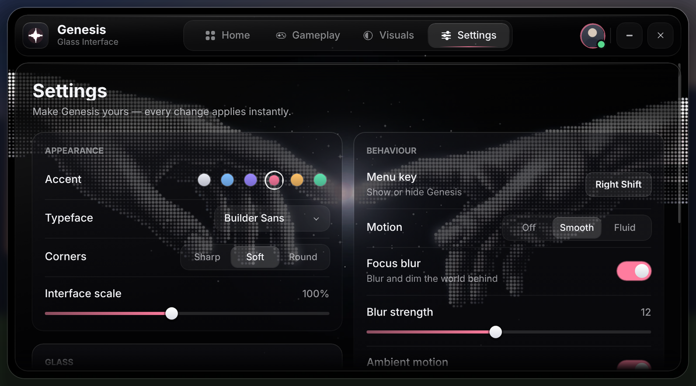

# Genesis — Glass Interface for Roblox

A black glass menu for Roblox experiences, built over the *Creation* artwork. The artwork fills the window and shows through every pane crisp and sharp. The glass tints it, lights its edges and keeps text readable, without hiding the image.



| Settings | Visuals | Accent colours |
| --- | --- | --- |
|  |  |  |

## What's inside

- **Glass window** with a top bar, sliding tab indicator, avatar, collapse and close controls, a soft drop shadow and a rim light on every edge.
- **Home**: a clear-glass hero that looks straight onto the fingertips, a time-of-day greeting, and live tiles for frame rate, latency, players and session time.
- **Gameplay**: field of view, hold-to-zoom key, crosshair styles and a performance chip.
- **Visuals**: bloom, sun rays, depth of field, colour tone presets, saturation, contrast and time of day, all applied on the player's screen only.
- **Settings**: the full config for the menu itself (see below), with cloud save.
- **Polish**: drifting stars and a breathing glow at the touch point, scroll edges that dissolve into the glass, spring-eased toggles and sliders, toasts, a dock pill to reopen the menu, and a fade-and-scale open animation that keeps the window pixel-sharp at rest.
- No third-party assets. Icons, shadows and glows are drawn from frames, so the only upload is your artwork, plus an optional frosted copy.

## Setup in Studio

1. **Upload the artwork.** Upload `assets/background.png` as an **Image**: Creator Dashboard → Development Items → Images, or Studio → View → Asset Manager → Import. Upload it unchanged (1024 × 558). `assets/background-frost.png` is optional. It's only used if you turn the Frost setting up.
2. **Add the menu.** In `StarterPlayer › StarterPlayerScripts`, create a **LocalScript** named `Genesis` and paste in `src/client/Genesis.client.lua`.
3. **Point it at your image.** At the top of the script, set the id. This repo already uses the uploaded artwork, `rbxassetid://88187297689824`, so this step is done unless you re-upload:
   ```lua
   Artwork = "rbxassetid://88187297689824",
   ArtworkFrost = "rbxassetid://0", -- optional: id of background-frost.png enables the Frost slider
   ```
   Use the *image* id. If you uploaded a Decal, drop it into an ImageLabel and copy the `Image` property, which is the image id.
4. **Optional: save settings between visits.** In `ServerScriptService`, create a **Script** named `GenesisConfig` and paste in `src/server/GenesisConfig.server.lua`. To test saving in Studio, publish the place and turn on Game Settings → Security → **Enable Studio Access to API Services**. Without this script the menu still works, and settings last for the session.
5. Press **Play**. The menu opens on its own. **Right Shift** toggles it.

### With Rojo

```sh
rojo build -o Genesis.rbxl   # or: rojo serve
```

`default.project.json` places the LocalScript in StarterPlayerScripts and the config script in ServerScriptService.

## Controls

| Action | How |
| --- | --- |
| Show / hide the menu | Right Shift (rebindable), or the dock pill at the top of the screen |
| Move the window | Drag the top bar |
| Collapse to the bar | The **–** button. Clicking any tab expands it again |
| Zoom the camera | Hold Z (rebindable) |

## Settings

| Section | Option | What it does |
| --- | --- | --- |
| Appearance | Accent | Platinum, Ice, Iris, Rose, Amber or Jade. Recolours toggles, sliders, the tab light, the glow and the crosshair live |
| | Typeface | Builder Sans, Gotham or Montserrat, applied everywhere |
| | Corners | Sharp, Soft or Round radius for every pane and control |
| | Interface scale | 80–125 %. The window always fits the screen and the top bar |
| Glass | Glass opacity | Strength of the black tint |
| | Frost | Off by default, so the artwork stays crisp. Raise it to frost the art behind the glass (needs the frost image) |
| | Artwork brightness | Dims the artwork behind everything |
| | Edge light | Rim light and specular line on every pane |
| Behaviour | Menu key | Click, then press any key. Esc cancels |
| | Motion | Off, Smooth or Fluid animation timing |
| | Focus blur, Blur strength | Blur and dim the world while the menu is open |
| | Ambient motion | Drifting stars and the breathing glow at the fingertips |
| | Notifications | Toasts for saves and changes |
| | Dock | Floating pill while the menu is hidden |
| Configuration | Auto-save, Save, Reset | Syncs through `GenesisConfig`. Reset asks for confirmation |

## Customising

All the knobs live in `CONFIG` at the top of the LocalScript: title, tagline, image ids, whether it opens on start and its display order. If you swap in different artwork, update `ArtworkSize` to its pixel size and `ArtworkFocus` to the point where the glow should breathe.

Pages are built from small helpers, so adding your own option takes a few lines:

```lua
-- 1. Give it a default (DEFAULTS) so it is saved and reset with everything else.
autoReload = true,

-- 2. Add a control inside a page's do-block.
local combat = section(left, "Combat")
toggle(combat, "Auto reload", "Reload when the magazine runs dry", "autoReload")

-- 3. React to it anywhere.
Settings.watch("autoReload", function(enabled)
	-- your code
end)
```

Available controls: `toggle`, `slider`, `dropdown`, `segmented`, `swatches`, `keybind` and `actionButton`. Call `notify(title, message, icon)` to show a toast.

## How the glass works

The window shows the artwork with `ScaleType.Crop`. Each pane on top is a black tint, a diagonal sheen, a rim-lit `UIStroke` and a one-pixel specular line, so the art shows through sharp. A soft shade behind the page title and darker card glass under small text keep everything legible over the halftone.

When Frost is raised, each pane also shows a pre-frosted copy of the artwork. That copy is cropped with `ImageRectOffset`/`ImageRectSize` to the exact rectangle behind the pane, and recropped whenever the pane moves, so the frost lines up with the image while you drag, scroll or animate.

Scroll edges dissolve because a strip of identical glass sits over each end of the content, inside a `CanvasGroup` faded with a `UIGradient`. The window and incoming pages pass through a `CanvasGroup` only while they animate, then return to normal frames, so text stays crisp at rest.

## Verification

Both scripts were run headless against a simulated Roblox client, built on [Lune](https://github.com/lune-org/lune). That client checks every class, property, value type and enum against Roblox's API reflection database, and lays out and renders the interface for review. 28 interaction checks pass: slider drags, frost on and off, key capture, dropdown picks, corner styles, accent changes, window drag, close/dock/reopen, hold-to-zoom, crosshair, performance chip, reset and Motion Off. 17 server checks pass: shared loads, throttled newest-wins saves, payload validation, flushing on leave and shutdown, and graceful handling when the DataStore is unavailable. Both files lint clean with Selene and are formatted with StyLua.

The previews above are renders of that simulated client. Inter stands in for Roblox's Builder Sans, and the world behind the window is a placeholder. The scripts have not yet been run inside Roblox Studio itself.

## Files

```
assets/background.png          artwork shown behind the glass (upload as an Image)
assets/background-frost.png    optional pre-frosted copy for the Frost setting
src/client/Genesis.client.lua  the menu (LocalScript → StarterPlayerScripts)
src/server/GenesisConfig.server.lua  optional cloud save (Script → ServerScriptService)
default.project.json           Rojo project
docs/                          preview renders
```
